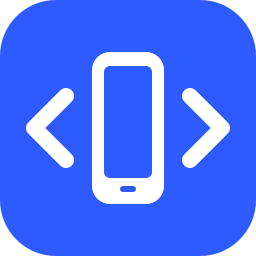
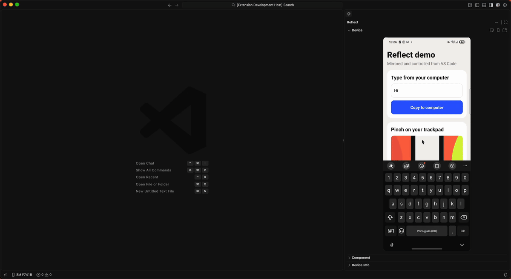

  

<h1 align="center">Reflect — Android &amp; iOS Simulator</h1>

  Mirror and control Android devices and iOS Simulators inside a VS Code tab — no external window.

  
  
  
  

  

## Why

Emulators are heavy, and mirroring a real phone usually means juggling an extra window. Reflect streams your phone's screen into an editor tab and lets you drive it with your mouse and keyboard, right next to your code. It is built for React Native developers, but works for any Android app.

Under the hood Reflect uses the [scrcpy](https://github.com/Genymobile/scrcpy) protocol through the [Tango](https://github.com/yume-chan/ya-webadb) libraries. Video is H.264 decoded with WebCodecs (hardware-accelerated where available), so it stays light on your machine.

## Features

### Mirror and control

- **Lives in the Secondary Side Bar**, right next to your code. Move it to an editor tab and back with one click (**Move to Editor Tab** / **Move to Side Bar**).
- **Live mirroring** of a USB-connected device with correct aspect ratio and low latency.
- **Touch and drag** with the mouse and **scroll** with the wheel or trackpad.
- **Pinch to zoom** with a two-finger trackpad pinch, <kbd>Option</kbd>/<kbd>Alt</kbd> + scroll, or <kbd>Option</kbd>/<kbd>Alt</kbd> + drag.
- **Keyboard input**, including special keys and editing shortcuts.
- **Clipboard sync**: <kbd>Cmd</kbd>/<kbd>Ctrl</kbd>+<kbd>V</kbd> pastes your computer's clipboard on the device; text copied on the device lands on your computer.
- **Mouse shortcuts**: right click = Back, middle click = Home.
- **Toolbar** above the screen: Back, Home, Recent Apps, Rotate, turn the physical screen off while mirroring, screenshot, recording, and the React Native shortcuts below.
- **Device frame and 1:1 zoom**: wrap the screen in a phone bezel, or show it at its real pixel size (scroll to pan). Both choices are remembered.
- **Automatic reconnection**: unplug the cable and plug it back in, and the mirror comes back on its own. After two minutes without the device, a **Reconnect** button appears.

### Screenshots and recordings

- **Screenshot** (PNG) and **MP4 recording** straight from the toolbar. Recordings keep the original H.264 stream, so there is no re-encoding and no extra CPU load.
- Files are saved to `reflect-captures/` in your workspace (configurable) and **copied to the clipboard**, ready to paste into Slack, a pull request or an issue. A notification lets you open the file or reveal it in Finder/Explorer.

### Tools panel

Below the mirror, a single **Tools** panel groups everything about the device and the app in tabs: **Component** (inspected component), **Network** (the app's HTTP requests), **Logs** (the app's console and logcat), **Storage** (AsyncStorage), **Device** (hardware and battery details), **Performance** (CPU, memory and frames) and **Actions** (testing shortcuts). Network and Storage appear while an app in development mode is connected. The active tab shows its name and the others just their icon; the panel remembers the last tab and works with the arrow keys.

### React Native tools

- **Component inspector**: click **Inspect** and move the mouse over the screen. The component under the cursor is highlighted like in the browser DevTools — content in blue, padding in green, margin in orange — with a label such as `<Text> in ProfileCard · ProfileCard.tsx:42`. Click to see its props and owners and jump straight to the line in your code. Works with React Native 0.76+ (including Expo) in development mode, with Metro running.
- **Performance**: live CPU, memory (PSS), frames per second and janky frames of the app in the foreground, each with a two-minute sparkline, plus frame-time percentiles (p50, p90, p99). Values above a threshold turn yellow. Pause, or reset the frame stats before a scroll test. Measured every 2 seconds, only while the tab is open.
- **Actions**: testing shortcuts on the phone — open a deep link (with your recent links); restart the app in the foreground, clear its data (asks first), open its settings or switch its language; see its runtime permissions grouped (Location, Camera, Notifications…) with Allowed / Denied / Partly allowed and toggle them; and flip dark mode, animations, show touches, layout bounds, Wi-Fi, mobile data, airplane mode, font size and a simulated battery level (5%, 15%, charging, full) from a grid of tiles.
- **Logs**: the logs of the app in the foreground — JavaScript `console.*` (tag `ReactNativeJS`) and native Android logs together, in order. Filter by text and minimum level, show only JavaScript, pause, copy what is visible and clear. Errors and crashes stand out, with stack traces kept together. Reflect reads only new lines while the Logs tab is open, so nothing keeps running on the phone.
- **Network inspector**: every `fetch`/`XMLHttpRequest` the app makes, with method, status, time and size. Filter by URL or status, open a request to see headers, request body and response (JSON formatted, images previewed), copy it **as cURL** or copy the response, pause and clear. Nothing to install in the app — Reflect hooks into it through Metro while the Network tab is open.
- **AsyncStorage editor**: a **Storage** tab appears in the **Tools** panel as soon as a React Native app in development mode is connected to Metro. Filter keys, see each value's type and size, edit it (JSON is formatted for you, <kbd>Cmd</kbd>/<kbd>Ctrl</kbd>+<kbd>S</kbd> saves to the phone), create new keys, delete one or all, and copy a value or everything as JSON. Nothing to install in the app — it also works in Expo Go.
- **Reload** the app and open the **Dev Menu** from the toolbar or with <kbd>Cmd</kbd>/<kbd>Ctrl</kbd>+<kbd>R</kbd> and <kbd>Cmd</kbd>/<kbd>Ctrl</kbd>+<kbd>M</kbd>, just like in an emulator.
- **Reverse Metro port**: runs `adb reverse tcp:8081 tcp:8081` (or your `reflect.metroPort`) so the app on the phone reaches Metro over USB.

### Everything else

- **Device** tab: model, Android version, display, battery level/temperature, memory, storage, Wi-Fi IP and the foreground app, refreshed every 5 seconds while visible.
- **Status bar item** showing the connected device — click it to open the mirror.
- **Clear errors** when `adb` is missing, the device is unauthorized or USB debugging is off.
- **Nothing left running**: closing the mirror stops the scrcpy server, closes the sockets, finishes any recording and releases the decoder. If the side bar stays hidden for 30 seconds the session is paused, and it resumes when you show it again.
- **No telemetry.**

### iOS Simulator

On a Mac, Reflect also mirrors the iOS Simulators you already have in Xcode, in the same side bar and with the same tools. Booted simulators show up under **iOS Simulators** in the empty Device view (and in the device picker); press **Bring to Reflect** to mirror one. Shut-down simulators have a **Boot** button that boots them headless — no Simulator window appears — and opens them as soon as they are ready.

**Requirements**

- macOS and **Xcode 26** or newer (older versions are reported as not supported).
- Nothing else to install: the small native helper that talks to the Simulator is bundled with the extension. Reflect clears the macOS quarantine flag on it the first time it runs.

**What works in this release**

- Live mirroring, touch, drag, scroll, keyboard and clipboard sync (paste into the simulator and copy back).
- Toolbar: Home, Recent Apps, Rotate, screen on/off, screenshot, recording, Dev Menu and Reload.
- Tools: Component inspector, Network and Storage for React Native apps in development mode.
- Closing and booting a simulator from the terminal is picked up within a couple of seconds: the mirror shows **Disconnected** and returns by itself when the simulator boots again.

**The Simulator app window.** While a simulator is mirrored in Reflect, the Simulator app is hidden so it does not cover your editor. Hiding applies to the whole app, so **all** Simulator windows are hidden, not just the mirrored one. Change this with `reflect.ios.simulatorWindow`: `hide` (default), `quit` (quits Simulator; booted simulators stay booted) or `leave`. After you close the mirror, the empty Device view offers **Show in Simulator** (also **Reflect: Show in Simulator**) to bring the app back.

Android devices and iOS Simulators can be connected at the same time. When you have several, the device picker lists both.

### Roadmap

Annotated screenshots and GIF export, Wi-Fi connections, dev tools (deep links, app actions, APK install, dark mode/font scale/locale, show touches, layout bounds, network toggles) and a filtered logcat panel.

## Requirements

- **VS Code 1.106** or newer (Cursor, Windsurf and VSCodium support through Open VSX is coming soon).
- **Android platform-tools** (`adb`). Install them with Android Studio or download them from [developer.android.com](https://developer.android.com/tools/releases/platform-tools).
- An Android device with **USB debugging enabled** ([how to enable](https://developer.android.com/studio/debug/dev-options#enable)) and Android 5.0 or newer.
- For iOS Simulators: a Mac with **Xcode 26** or newer. See [iOS Simulator](#ios-simulator).

## Installation

- **VS Code Marketplace**: search for "Reflect — Android & iOS Simulator" in the Extensions view, or run `code --install-extension GabrielCordeiro.reflect-android`.
- **Open VSX** (Cursor, Windsurf, VSCodium): coming soon.

## Usage

1. Connect your phone via USB and accept the "Allow USB debugging" prompt.
2. Click the **Reflect** icon in the Secondary Side Bar (<kbd>Cmd</kbd>+<kbd>Option</kbd>+<kbd>B</kbd> / <kbd>Ctrl</kbd>+<kbd>Alt</kbd>+<kbd>B</kbd> shows it) and press **Open Device**, run **Reflect: Open Device** from the Command Palette, or click the device in the status bar.
3. If more than one device is connected, pick one from the list.
4. Click inside the mirrored screen to focus it, then use your mouse and keyboard.

Prefer a bigger screen? Click **Move to Editor Tab** in the view title (or run **Reflect: Move to Editor Tab**), or set `reflect.location` to `editor`. **Move to Side Bar** brings it back.

### Inspecting a React Native component

1. Start your app in development mode (`npx expo start` or `npx react-native start`) with Metro on `reflect.metroPort`.
2. Click the **Inspect** button in the Device view title, or run **Reflect: Inspect Component**.
3. Move the mouse over the screen to see each component highlighted, then click one. The **Tools** panel switches to the **Component** tab with its props and owners, and its source line opens in the editor. Press <kbd>Esc</kbd> to stop inspecting.

### Editing AsyncStorage

1. Open the device and start your app in development mode with Metro running.
2. The **Storage** tab shows up in the **Tools** panel with every key, its type (`{}` object, `[]` array, `""` text, `#` number…) and size. Type in the box at the top to filter.
3. Click a key (or use the arrow keys) to open its value. Edit it and press **Save** or <kbd>Cmd</kbd>/<kbd>Ctrl</kbd>+<kbd>S</kbd>; invalid JSON is flagged before saving. **Copy** and **Delete** are right there. Values that are image links (`.png`, `.jpg`, `.webp`, `.svg`…) or `data:image` strings show a preview with the image size.
4. Use **+** to create a key, and the view title for **Refresh**, **Copy AsyncStorage as JSON** and **Delete All AsyncStorage Keys**. Deleting always asks first.

Reflect talks to `@react-native-async-storage/async-storage` inside your running app, so changes are real: the app sees them immediately (reload the screen to re-read them). MMKV and SecureStore are not supported yet.

### Keyboard shortcuts

These work while the mirror has focus.

| Action | macOS | Windows / Linux |
| --- | --- | --- |
| Back | <kbd>Cmd</kbd>+<kbd>Backspace</kbd> | <kbd>Ctrl</kbd>+<kbd>Backspace</kbd> |
| Home | <kbd>Cmd</kbd>+<kbd>Shift</kbd>+<kbd>H</kbd> | <kbd>Ctrl</kbd>+<kbd>Shift</kbd>+<kbd>H</kbd> |
| Reload React Native app | <kbd>Cmd</kbd>+<kbd>R</kbd> | <kbd>Ctrl</kbd>+<kbd>R</kbd> |
| Open Dev Menu | <kbd>Cmd</kbd>+<kbd>M</kbd> | <kbd>Ctrl</kbd>+<kbd>M</kbd> |
| Screenshot | <kbd>Cmd</kbd>+<kbd>Shift</kbd>+<kbd>S</kbd> | <kbd>Ctrl</kbd>+<kbd>Shift</kbd>+<kbd>S</kbd> |
| Rotate | <kbd>Cmd</kbd>+<kbd>Right</kbd> | <kbd>Ctrl</kbd>+<kbd>Right</kbd> |

Every toolbar action is also a command (**Reflect: Back**, **Reflect: Take Screenshot**, **Reflect: Start/Stop Recording**, …), so you can bind your own shortcuts in **Keyboard Shortcuts**.

### Screenshots and recordings

- Click the camera to take a screenshot, or the record button to start and stop an MP4 recording. A timer shows while recording.
- Files are named like `reflect-pixel-8-20261016-142530.png` and saved to `reflect.capturesDirectory`.
- With `reflect.copyCapturesToClipboard` on, screenshots are copied as images and recordings as files (macOS and Windows), so a plain paste works. On Linux, screenshots need `xclip`; otherwise the file path is copied instead.

## Settings

| Setting | Default | Description |
| --- | --- | --- |
| `reflect.adbPath` | `""` | Absolute path to the `adb` executable. Leave empty to auto-detect. |
| `reflect.location` | `secondarySidebar` | Where **Reflect: Open Device** shows the device: `secondarySidebar` or `editor`. |
| `reflect.metroPort` | `8081` | Metro port used by the component inspector. |
| `reflect.inspector.openSourceOnSelect` | `true` | Open the source file of an inspected component automatically. |
| `reflect.privacy.maskIpAddress` | `false` | Hide the last part of the IP address in the Device tab (handy for screenshots). |
| `reflect.capturesDirectory` | `reflect-captures` | Folder for screenshots and recordings. Relative paths use the first workspace folder; without a workspace they go to `~/Pictures/Reflect`. |
| `reflect.copyCapturesToClipboard` | `true` | Copy screenshots (as images) and recordings (as files) to the clipboard. |
| `reflect.ios.simulatorWindow` | `hide` | What to do with the Simulator app when a simulator is brought into Reflect: `hide`, `quit` or `leave`. |

When `reflect.adbPath` is empty, Reflect looks for `adb` in this order: `$ANDROID_HOME/platform-tools` (or `$ANDROID_SDK_ROOT`), the default SDK location for your OS, then your `PATH`.

## Troubleshooting

| Problem | What to try |
| --- | --- |
| "adb not found" | Install platform-tools or set `reflect.adbPath`. |
| "device not authorized" | Unlock the phone and accept the USB debugging prompt. If it does not appear, revoke USB debugging authorizations in Developer options and reconnect. |
| "device is offline" | Reconnect the cable, try another USB port or cable, or toggle USB debugging. |
| Black screen | Open **View → Output → Reflect for Android** and check the `[webview]` lines. Include them when you open an issue. |
| Input does nothing | Click the mirrored screen first so it receives focus. |
| "Metro is not running" when inspecting | Start your app with `npx expo start` or `npx react-native start`, or set `reflect.metroPort`. |
| "No debuggable React Native app" | Open the app in development mode. The inspector needs React Native 0.76 or newer. |
| The app on the phone cannot reach Metro | Click **Reverse Metro Port** in the toolbar, or run `adb reverse tcp:8081 tcp:8081`. |
| Reload does nothing | Reload uses Metro; without it Reflect falls back to pressing <kbd>R</kbd> twice, which needs the app in development mode. |
| The mirror says "Device not found" | Check the cable and that USB debugging is still on, then click **Reconnect**. |
| "Nothing was recorded" | The recording was stopped before the first video frame arrived. Record for at least a second. |
| No highlight while inspecting | Make sure Metro is running and the app is in development mode. Only components rendered by React Native's new architecture (Fabric) are supported. |

## Contributing

Contributions are very welcome! Please read [CONTRIBUTING.md](CONTRIBUTING.md) for the local setup, the testing rules (100% coverage is required) and the pull request flow. By participating you agree to the [Code of Conduct](CODE_OF_CONDUCT.md).

Found a security issue? Please follow [SECURITY.md](SECURITY.md) instead of opening a public issue.

## ☕ Support the project

Reflect is free and open source. If it saves you time, you can support its development:

- [GitHub Sponsors](https://github.com/sponsors/GabrielCordeiroBarrosoTeles)
- 🇧🇷 **PIX**: scan the QR code below with your bank app

Starring the repository and sharing it with other developers helps a lot too.

## Credits and licenses

- Reflect for Android is released under the [MIT License](LICENSE).
- It bundles the **scrcpy server** by Genymobile and Romain Vimont, licensed under the [Apache License 2.0](assets/scrcpy-server.LICENSE).
- It uses the **Tango** (`@yume-chan/*`) libraries by Simon Chan, licensed under the MIT License.

See [THIRD_PARTY_NOTICES.md](THIRD_PARTY_NOTICES.md) for the full attributions.
